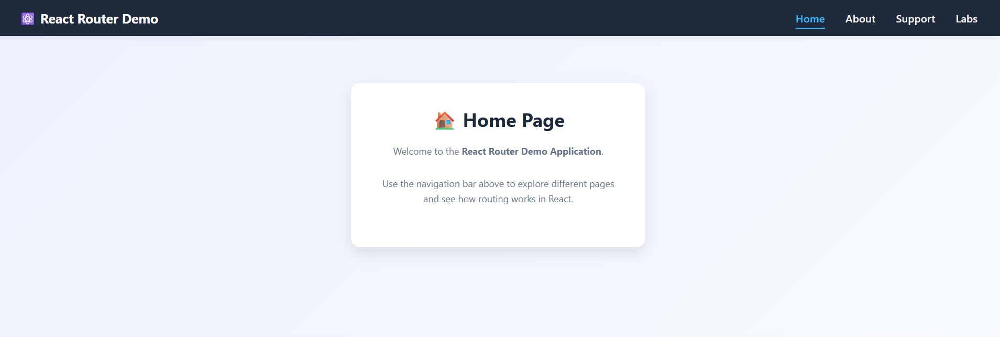
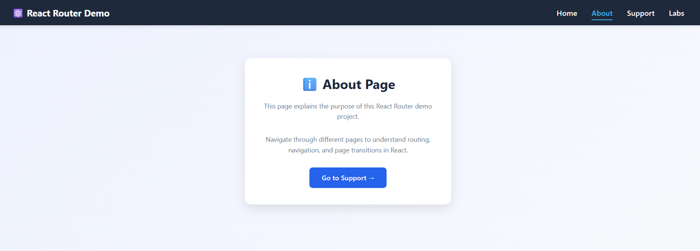
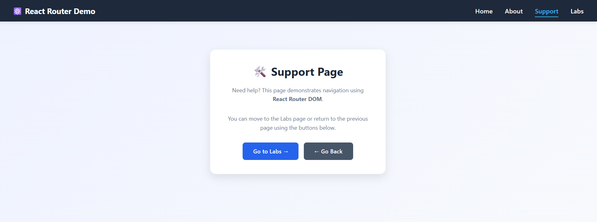
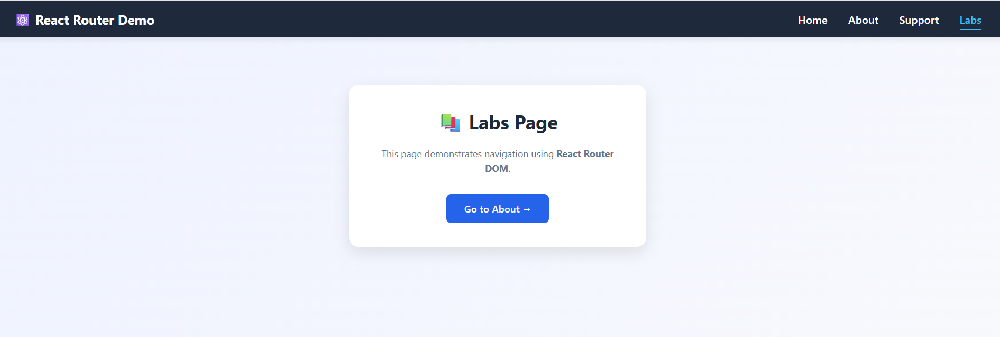

# ⚛️ React Router Demo

A modern React application demonstrating **client-side routing** using **React Router DOM**. This project showcases page navigation, programmatic routing, active links, and a custom UI with a clean, responsive design.

---

## 🚀 Live Demo

🔗 https://react-router-demo-eta.vercel.app/
---

## ✨ Features

- 🏠 Home Page
- ℹ️ About Page
- 🛠️ Support Page
- 📚 Labs Page
- 🔄 Client-side Routing with React Router DOM
- 🎯 Active Navigation Links using `NavLink`
- 🚀 Programmatic Navigation using `useNavigate`
- 📱 Responsive & Clean UI
- 🎨 Modern Navigation Bar

---

## 🛠️ Tech Stack

- React
- React Router DOM
- CSS3
- Vite
- JavaScript (ES6)

---

## 📂 Project Structure

```text
src
│── components
│   ├── Home.jsx
│   ├── About.jsx
│   ├── Support.jsx
│   ├── Labs.jsx
│   ├── MainHeader.jsx
│   └── NotFound.jsx
│
├── App.jsx
├── App.css
├── index.css
└── main.jsx
```

---

## 📸 Screenshots

### 🏠 Home Page



### ℹ️ About Page



### 🛠️ Support Page



### 📚 Labs Page



---

## 📚 React Concepts Practiced

- React Components
- React Router DOM
- Routes & Route
- Nested Routes
- Outlet
- NavLink
- useNavigate Hook
- Component-based Architecture

---

## ⚙️ Installation

```bash
git clone https://github.com/Arsh173/react-router-demo.git

cd react-router-demo

npm install

npm run dev
```

---

## 👨‍💻 Author

**Arsh**

- GitHub: https://github.com/Arsh173
- LinkedIn: https://linkedin.com/in/arsh0786

---

⭐ If you found this project helpful, consider giving it a star!